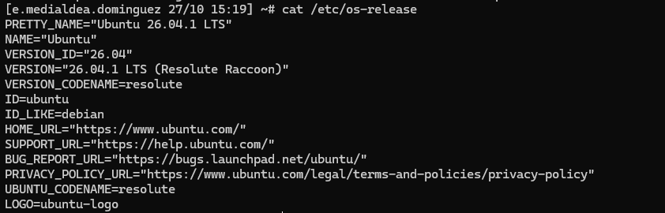
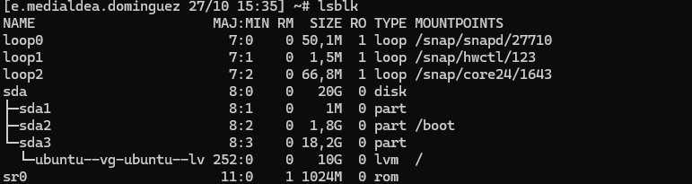
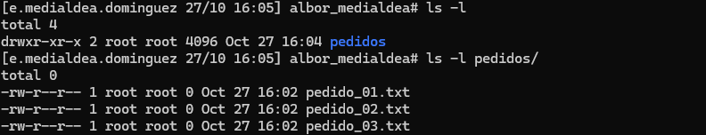
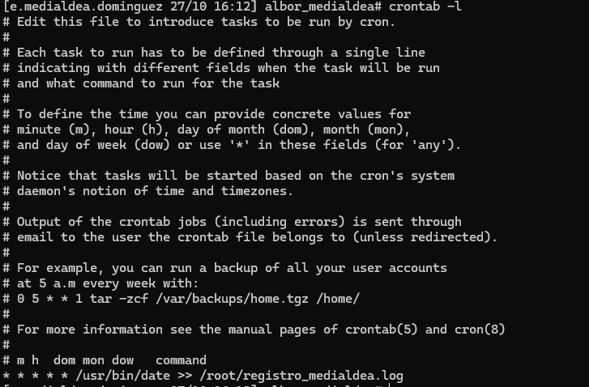
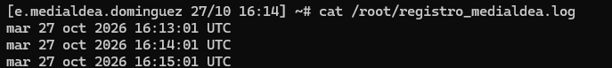
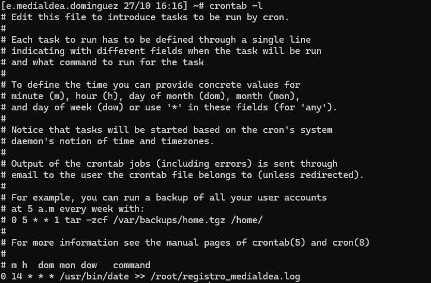
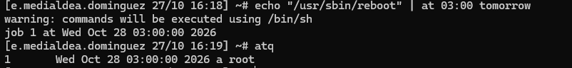

# Administración de sistemas Linux | Ubuntu Server

**Proyecto académico de ASIR — Inventario, almacenamiento, gestión de archivos y automatización**

## Descripción

En esta práctica de Administración de Sistemas Operativos de ILERNA trabajé con un servidor **Ubuntu 26.04.1 LTS** en un escenario académico para la empresa ficticia *Imprenta Albor*. Realicé un inventario técnico del sistema, analicé los recursos de memoria y disco, organicé archivos desde la terminal y configuré tareas programadas.

Este repositorio recoge mis procedimientos y las capturas obtenidas en el laboratorio. Está redactado como documentación técnica propia, no como una reproducción completa de la PAC.

## Tecnologías y herramientas

- Ubuntu Server, terminal de Linux y comandos GNU/Linux.
- Identificación del sistema y kernel: `uname`, `/etc/os-release`.
- Memoria y almacenamiento: `free`, `lsblk`, `df`, `du` y LVM (análisis de la configuración existente).
- Gestión de archivos: `mkdir`, `cd`, `touch`, `mv`, `rm`, `ls`.
- Automatización: `cron`, `crontab` y `at`.
- Conceptos de diseño: particionado GPT y arranque UEFI.

## 1. Inventario del servidor

Comencé identificando el sistema operativo, la versión del kernel y la arquitectura del equipo:

```bash
uname -a
cat /etc/os-release
uname -r
```

Las comprobaciones mostraron Ubuntu 26.04.1 LTS, kernel `7.0.0-38-generic` y arquitectura `x86_64`. Diferencié la versión de la distribución de la versión del kernel.




## 2. Análisis de memoria y almacenamiento

Consulté los recursos disponibles con:

```bash
free -h
lsblk
df -h /
du -sh /etc
```

En el entorno documentado observé aproximadamente **3,3 GiB de RAM total**, **2,7 GiB disponibles**, y un volumen lógico de raíz de **9,8 GB**, con **6,0 GB libres**. Identifiqué el disco `/dev/sda`, una partición utilizada por LVM y el volumen lógico `ubuntu-lv` montado en `/`.

También comparé `df` (uso y espacio disponible del sistema de archivos) con `du` (tamaño ocupado por un directorio). Usé estos datos para justificar que, en ese momento, el servidor cumplía los requisitos de memoria y espacio de una aplicación hipotética de gestión de pedidos.





## 3. Organización de archivos mediante terminal

Creé una estructura de trabajo para simular la gestión de pedidos y practiqué comandos de creación, movimiento, eliminación y listado de archivos.

```bash
mkdir ~/albor_medialdea
cd ~/albor_medialdea
touch pedido_01.txt pedido_02.txt pedido_03.txt presupuesto.odt
mkdir pedidos
mv pedido_*.txt pedidos/
rm presupuesto.odt
ls -l
ls -l pedidos
```

Comprobé que los tres archivos de pedidos quedaban dentro de la carpeta `pedidos`.



## 4. Automatización de tareas con cron y at

Configuré una tarea para registrar la fecha y la hora periódicamente. Primero utilicé una entrada de `cron` cada minuto y comprobé la escritura en un archivo de registro:

```cron
* * * * * /usr/bin/date >> /root/registro_medialdea.log
```

Después modifiqué la programación para ejecutarla todos los días a las 14:00:

```cron
0 14 * * * /usr/bin/date >> /root/registro_medialdea.log
```

Finalmente programé **un reinicio único para el día siguiente a las 03:00** mediante `at`:

```bash
echo "/usr/sbin/reboot" | at 03:00 tomorrow
```

La captura acredita que el trabajo quedó **registrado en la cola de `at`**, pero no muestra la ejecución posterior del reinicio. Las tareas que escriben en `/root/` requieren ejecutarse con los permisos adecuados, como en el laboratorio.









## 5. Propuesta de particionado para un servidor nuevo

Como parte de la actividad, razoné qué diseño emplearía para un servidor que necesita una partición de datos de gran tamaño: **GPT con arranque UEFI** y una **partición ESP** en FAT32 para los archivos de arranque. Esta sección representa un análisis y propuesta, **no la ejecución de una nueva instalación ni un cambio real de particiones**.

## Evidencias adicionales

| Archivo | Qué documenta |
|---|---|
| [01-identificacion-kernel.png](capturas/01-identificacion-kernel.png) | Identificación inicial con `uname -a` |
| [07-tamano-etc.png](capturas/07-tamaño-etc.png) | Comprobación del tamaño de `/etc` |

Todas las capturas se encuentran en la carpeta [`capturas/`](capturas/).

## Aprendizajes

Con este laboratorio reforcé mi capacidad para recopilar información de un sistema Linux, interpretar recursos de memoria y almacenamiento, trabajar con archivos desde terminal y configurar y comprobar tareas automatizadas. También practiqué cómo justificar decisiones de infraestructura a partir de requisitos concretos.

## Nota del laboratorio

Las configuraciones, nombres y recursos mostrados corresponden a un entorno académico. Algunas acciones, como programar un reinicio, se documentan como configuradas cuando no existe evidencia de su ejecución posterior. No se incluyen contraseñas ni claves privadas.

## Autor

**Eduardo Medialdea Dominguez**  
Estudiante de segundo curso de ASIR — ILERNA  
*Documentación propia basada en una práctica académica. No se publican datos privados, claves ni material docente sin autorización.*
